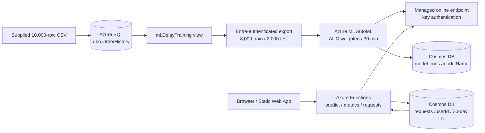

# Contoso delivery intelligence

A delay classifier with a web portal, a validating API, request tracing, and service health. The Azure design uses SQL → AutoML → a managed endpoint, with Functions and Cosmos DB behind a Static Web App.

**Current status:** The Azure SQL → AutoML → endpoint → Functions → Cosmos pipeline is working. Live predictions, matching Cosmos point reads, both held-out model evaluations, SQL analyses and Cosmos query charges are verified. The Azure load test completed 100 requests at concurrency 5: 98 successes, two tracked errors, client p50 851 ms and p95 1,378 ms. Actual Azure screenshots are in `screenshots/`. Training clusters are deleted; the live endpoint remains active. The trial spending limit remains enabled and a ₹500 budget alert is active. **The demo and deliberate Azure failure/recovery tests are complete.**

**Demo:** [Watch/download the 3:47 MP4](https://github.com/harshithRai/contoso-delay-classifier/releases/download/demo-2026-10-27/contoso-delay-demo.mp4) · [Narration and chapters](demo/README.md). The demo uses actual Brave window frames captured about once per second, edited under computer-generated narration.

**Portal:** [polite-flower-00190c500.1.azurestaticapps.net](https://polite-flower-00190c500.1.azurestaticapps.net).

**Repository:** [harshithRai/contoso-delay-classifier](https://github.com/harshithRai/contoso-delay-classifier). Author: Harshith Rai.

**Submission deadline:** 26 October 2026, 11:59 PM IST, from the updated class post. That post's public-repository requirement overrides the older PDF's dates/private-repository option. Session name has not been supplied.

## Run locally

Requirements: Node.js 22 and Python 3.9–3.11. Python 3.11 is recommended for a fresh setup. Commands below run from this directory.

```bash
python3 -m venv .venv
.venv/bin/python -m pip install -r requirements.txt
.venv/bin/python ml/train_local.py
npm run dev
```

Open **http://127.0.0.1:7071**. The local scorer listens only on port 7072. No Azure account or npm installation is needed for local mode. The API talks to a real fitted scikit-learn model; logs persist under ignored `.local/requests/`. The portal clearly identifies local mode. Keep the terminal running; Ctrl+C stops both servers. The included virtual environment/model artifact are local conveniences and are not published in git; training recreates them.

```bash
npm run check
.venv/bin/python -m unittest discover -s tests -p 'test_*.py'
python3 tests/load_test.py --count 100 --concurrency 5 --out evidence/local-load-test.json
```

Deployment instructions are in [docs/AZURE_SETUP.md](docs/AZURE_SETUP.md). Actual cloud screenshots and reports are indexed in [docs/AZURE_EVIDENCE.md](docs/AZURE_EVIDENCE.md). Recording steps are in [docs/EVIDENCE_AND_DEMO.md](docs/EVIDENCE_AND_DEMO.md). The comment template is in [docs/SUBMISSION.md](docs/SUBMISSION.md).

## Architecture



The browser knows only same-origin `/api/*` routes and an anonymous browser ID. ML/Cosmos credentials stay in server settings. SQL is the typed source of truth for historical orders; Cosmos holds model metadata and operational documents. Local mode substitutes a loopback scorer and a file-backed store, explicitly, without silently falling back when Azure fails.

## Project map

| Folder | Purpose |
|---|---|
| `sql/` | Table, view, three analysis queries, Entra-authenticated batch loader |
| `ml/` | SQL export, MLTable template, local training, Azure AutoML submission, two-model evaluation and deployment |
| `cosmos/` | Real Azure result upserts and Data Explorer queries |
| `app/` | Accessible, responsive portal, loading/error states, health chart and request explorer |
| `api/` | Three Azure Functions, shared validation, inference, persistence and metrics |
| `infra/` | Azure resource and budget Bicep templates |
| `tests/` | Behavioral API tests, metric checks, real-model report check, concurrent load script |
| `evidence/` | Actual measured local reports; Azure reports are generated after deployment |
| `screenshots/` | Screenshots prefixed `local-` are local evidence only |
| `docs/` | Cloud runbook, evidence checklist, demo narration and submission template |

## Part A — data and analysis

The original [dataset](https://github.com/UmashankarKH/database_azure/blob/main/contoso_delay_training.csv) contains **10,000 orders and 1,807 delays (18.07%)**. Retrieved upstream Git blob: `54dd4514edf7ff0eb4d313a32f7fa09a629a5a0e`; local CSV SHA-256: `88446d17b6c5af704aac620803985b8e0be5c9b764bdc266d64cada723aa5680`. The source is the [class repository](https://github.com/UmashankarKH/database_azure).

These results were verified by running `sql/analysis.sql` against the deployed **Azure SQL** database. Actual service output, including the 10,000-row count, is saved in `evidence/azure-sql-analysis.json`. The earlier CSV comparison remains in `evidence/local-analysis.json`.

| Carrier | Orders | Delays | Delay rate |
|---|---:|---:|---:|
| IndiaPost | 1,563 | 447 | 28.60% |
| EcomExp | 1,988 | 400 | 20.12% |
| Delhivery | 3,428 | 562 | 16.39% |
| BlueDart | 3,021 | 398 | 13.17% |

| Sale day | Orders | Delays | Delay rate |
|---|---:|---:|---:|
| No | 8,852 | 1,438 | 16.24% |
| Yes | 1,148 | 369 | 32.14% |

| Backlog | Orders | Delays | Delay rate |
|---|---:|---:|---:|
| Under 30 | 404 | 58 | 14.36% |
| 30–49 | 8,873 | 1,580 | 17.81% |
| 50+ | 723 | 169 | 23.37% |

Sale days have about 1.98× the normal-day delay rate. The highest versus lowest backlog bucket differs by about 1.63×, and the highest versus lowest carrier rate by about 2.17× (28.60% versus 13.17%). These associations do not prove causation: distances, weather and carrier choice may be related. Multivariable modeling can rank features differently from these separate comparisons.

The loader inserts batches of 1,000 using Entra tokens and strict TLS. It uses ODBC Driver 18 when available, or parameterized OPENJSON batches through Python TDS otherwise. It refuses to append into an existing nonempty table, preventing accidental duplicate imports. Training export explicitly reads `ml.DelayTraining`, whose only columns are the eight features and `delayed`; the identity column cannot leak into training.

## Part B — measured local model results

Local training uses a stratified 80/20 split with seed 42. Both models use 3-fold stratified CV on the 8,000 training rows, and selection uses mean training-CV AUC. Preprocessing is fitted inside each CV fold. Final reported metrics use the untouched 2,000-row test set (361 delayed). These local results must be replaced or supplemented by actual Azure AutoML results after deployment.

| Model | CV AUC | Test AUC | Accuracy | Precision (late) | Recall (late) | F1 (late) |
|---|---:|---:|---:|---:|---:|---:|
| Logistic regression — selected | 0.7566 | 0.7429 | 0.8310 | 0.6139 | 0.1717 | 0.2684 |
| Balanced random forest | 0.7386 | 0.7311 | 0.7710 | 0.3939 | 0.4986 | 0.4401 |

The selected model's AUC advantage on this test split is modest (0.0119), and one split does not establish statistical significance. The random forest catches far more late orders at its default decision rule, so a business choice should weigh missed delays and false alarms rather than rank models using accuracy alone.

Confusion matrices use rows = actual `[on time, delayed]`, columns = predicted `[on time, delayed]`:

```text
Logistic regression       Random forest
[[1600,  39],             [[1362, 277],
 [ 299,  62]]              [ 181, 180]]
```

**Why is 82% accuracy misleading?** Always predicting on time scores 81.93% on the full dataset, while its recall for delayed orders is zero. AUC measures ranking across thresholds; delayed-class precision/recall/F1 and the confusion matrix reveal what the actual operating decision does.

**Which features matter?** Local permutation importance measured by test AUC drop ranks distance (0.1196), weather (0.0442), carrier (0.0312), sale day (0.0285), weight (0.0113), and backlog (0.0072) highest. Sale day and carrier support the grouped analysis, but distance and weather are stronger in the multivariable model. This is local model evidence, not an Azure explanation; record the Azure model explanation separately.

**What does a missed delay cost, and is the threshold right?** A false on-time prediction can prevent a proactive customer update and lead to complaints, rescheduling, refunds or expedited shipping. The default logistic-regression rule misses 299 of 361 actual delays, so it is a reproducible starting point rather than an adequate operating threshold for a delay-alert service. Before a real rollout, use training-only out-of-fold/validation probabilities to choose a lower threshold against an explicit false-negative/false-positive cost ratio; report its performance once on the held-out test set. Do not tune on that test set. The portal displays a class and does not invent a confidence percentage.

The cloud path uses AutoML classification, primary metric `AUC_weighted`, a 30-minute limit and a 0–1-node training cluster. `collect_azure.py` ranks completed candidates and evaluates the best two on the untouched SQL export, reusing the model's recorded Microsoft runtime image, with its conda export as fallback. It records delayed-class metrics and confusion matrices, rather than relabeling weighted averages. Evaluation jobs are checkpointed and reports are retrieved through MLflow artifacts. A temporary 0–1-node `Standard_DS2_v2` cluster avoids blocking behind AutoML's separate explanation job. The winner is deployed on one `Standard_D2as_v4` instance, using a separate available quota family. Actual endpoint responses are `[false]` / `[true]`; the API maps these to on-time/delayed labels.

## Measured Azure AutoML results

AutoML completed ten candidates. Selection uses training-CV weighted AUC; the held-out SQL export has 2,000 rows, including 361 delayed orders. Its row ordering differs from the local CSV split, so local/cloud test metrics are not a controlled comparison.

| Azure model | CV AUC | Test AUC | Accuracy | Precision (late) | Recall (late) | F1 (late) |
|---|---:|---:|---:|---:|---:|---:|
| PreFittedSoftVotingClassifier — deployed | 0.7439 | 0.7240 | 0.8215 | 0.8333 | 0.0139 | 0.0272 |
| StackEnsembleClassifier | 0.7438 | 0.7257 | 0.8275 | 0.5889 | 0.1468 | 0.2350 |

Confusion matrices (actual rows/predicted columns: on-time, delayed):

```text
Voting: [[1638, 1], [356, 5]]
Stack:  [[1602, 37], [308, 53]]
```

The selected model misses 356 of 361 delays at its default decision rule. Its 82.15% accuracy is close to the 81.95% always-on-time baseline. High precision comes from only six positive predictions. The stack model catches more delays, but it was not selected using the held-out set: the CV AUC winner was fixed first. The CV scores differ by only 0.00008 and do not establish a meaningful performance difference. Threshold tuning on training-only validation data is needed before a business rollout.

Azure-held-out permutation importance ranks distance, weather, carrier and sale day highest. Raw metrics, confusion matrices, run IDs, feature importance and deployment metadata are in `evidence/azure-training.json`. Both actual model documents were upserted into Cosmos DB. A live successful prediction and matching Cosmos document are in `evidence/azure-live-prediction.json`.

## Part C — Cosmos design

`model_runs` uses **`/modelName`** so runs of the same model can be queried together; TTL is off. The workload is small and infrequent, and this intentionally prioritizes model-history access rather than pretending that one model creates high cardinality. `requests` uses **`/userId`**, which keeps a browser's last 20 requests and `(id, userId)` lookups in one partition while distributing many users across partition values. `/carrier` has only four values and would concentrate traffic; a constant request key would put everything into one logical partition. One exceptionally busy user can still become hot, and a production design would revisit partitioning and rollups for that workload.

A point read provides the exact item address and partition, so it avoids query planning and scanning. Actual charges for runs ordered by AUC, deployed-run count and recall below 0.5 were **3.16 RU, 2.82 RU and 2.85 RU**. The supplied request ID `b5084d64-a2dc-4992-a570-a6131695e95f` was found with its exact browser partition in **1 RU**. Results and charges are saved in `evidence/azure-cosmos.json`, with Data Explorer screenshots. Charges describe these executions and can change with query/data size.

Request documents expire after 2,592,000 seconds. A small `type: counter`, `id: __counter`, `ttl: -1` document in each user partition retains its cumulative request count after detailed logs expire. Creating a request and incrementing that count is a Cosmos transactional batch, so the two cannot diverge on a successful transaction. All request queries explicitly filter `type = 'request'`. Global health aggregates across partitions; that is appropriate for the exercise but costs more as traffic grows.

## Parts D/E — API and observation rules

| Route | Behavior |
|---|---|
| `POST /api/predict` | Eight fields + optional `userId`; validates types/ranges/carrier, calls ML with 10-second timeout, persists one request, returns ID/class/latency/status |
| `GET /api/metrics` | Global request counts, successful latency p50/p95, slowest, system error rate, first/idle call marker and last 50 latencies |
| `GET /api/requests?userId=…` | Last 20 requests for this browser |
| `GET /api/requests?userId=…&requestId=…` | Cosmos point read using both identifiers |

The API rejects missing values, booleans in numeric fields, strings instead of numbers, nonfinite values, fractional integers, extra keys, unsupported carriers, and out-of-range values. Bounds are distance 1–10,000 km, weight 0.01–50 kg, items 1–50, hour 0–23, sale flag 0/1, backlog 0–1,000, weather 0–1. These permit reasonable inputs beyond the observed training range; predictions that far beyond the training data should be treated cautiously. Invalid values never reach the model. Rejected-input logs retain only known numeric fields and allowlisted carriers, excluding arbitrary strings and unknown fields.

`ok`, `invalid`, and `error` remain distinct. Invalid requests return 400; upstream/model failures return 502; model timeouts return 504; unavailable persistence returns 503. No raw dependency exception reaches the browser. If no valid browser ID is supplied, the API creates one and returns it. All prediction responses produced by the handler have a request ID; platform rejection before the handler and a complete transport outage cannot provide one.

**Metric definitions:**

- Request count: every prediction attempt in the last 15 minutes; cumulative all-time count comes from the durable counters.
- p50: median successful `totalLatencyMs` values among the most recent 100 attempts, averaging the middle pair for an even sample size.
- p95: nearest rank, `ceil(0.95 × n) - 1` with zero-based indexing, using that same successful subset.
- Slowest: maximum total latency among the last 100 attempts, including failures and invalid input.
- Error rate: `error / (ok + error) × 100` over the last 15 minutes. Invalid input is excluded. Red alert threshold: **strictly above 5%**.
- Chart: last 50 attempts, including invalid/error records in separate colors. The recent table and ID lookup use this browser's ID.
- First/idle call: first handler call in a worker, or first call after at least 10 idle minutes in that worker. It is a cold-start **proxy**, not a direct measurement of Azure host initialization. It does not claim a global cold start across scaled-out workers.

`modelLatencyMs` covers the endpoint request and response parsing. `databaseWriteMs` covers the initial durable write/batch. `totalLatencyMs` runs from entry to completion of that initial persistence; a final replace stores the measured write-inclusive total and is necessarily excluded from its own timing. Browser/client wall time also includes final replacement, network transfer and rendering. If finalization fails, the initial record remains an explicit tracking error and the API returns 503. If Cosmos is wholly unavailable no service can guarantee a Cosmos write; the API emits a safe request-ID-only server error event and does not claim a successful tracked prediction.

### Executed local operations tests

| Test | Result |
|---|---|
| 100 calls, concurrency 5 | Client p50 9 ms; p95 12 ms; 0% errors; 0.206 s total |
| Wrong local model key, 10 calls | All 10 returned tracked errors; 100% error rate in the failure cohort |
| Portal failure view, additional call | Friendly error message, request ID and failed history row; 15-minute global rate rose to 9.8% |
| Restored service, 120 calls at concurrency 5 | 0% errors in recovery cohort; global health rate fell to 4.7% |
| Automated checks | API behavioral tests and model report checks; Python source syntax; Azure templates validated separately as recorded in `evidence/verification.md` |

Raw results: `evidence/local-load-test.json`, `local-failure-test.json`, `local-recovery-test.json`. These use local processes, not an Azure VM. Screenshots prefixed `local-` show local behavior only.

### Executed Azure load test

| Measurement | Actual result |
|---|---:|
| Requests / concurrency | 100 / 5 |
| ML deployment | Standard_D2as_v4, 1 instance |
| Successful / failed / invalid | 98 / 2 / 0 |
| Client p50 / p95 (successful requests) | 851 / 1,378 ms |
| Error rate | 2.0% |
| Total elapsed | 20.285 seconds |

Raw responses and request IDs are in `evidence/azure-load-test.json`. Both HTTP 502 failures were independently found in Cosmos DB, as recorded in `evidence/azure-evidence-verification.json`. Their safe generic error messages establish a model/dependency failure but do not identify the upstream status or root cause. The observed errors are retained in the reported result. The deliberate wrong-key/recovery experiment is recorded below.

The portal measures handler time through the initial durable write; client measurements also include transport and finalization. For example, the supplied actual Azure request recorded 445 ms for the model call, 305 ms for the initial Cosmos write and 751 ms total handler time. Rolling health metrics can differ from the fixed load-test cohort. The first/idle marker is a proxy and does not establish Azure host cold-start cost. Production improvements include Application Insights spans, rollups to reduce cross-partition polling and endpoint sizing based on measured p95.

### Executed Azure failure and recovery tests

| Cohort | Requests / concurrency | Result | Client p50 / p95 |
|---|---|---|---|
| Initial deliberately invalid API model key | 10 / 1 | 10 tracked errors, 100% error rate | No successful latency sample |
| Real key restored | 120 / 5 | 116 successes, 4 errors (3.33%) | 905 / 2,049 ms |
| Separate lower-concurrency follow-up | 240 / 2 | 240 successes, 0 errors | 704.5 / 923 ms |
| Repeat failure take for the saved video | 10 / 1 | 2 successes, 8 errors while settings propagated | 945.5 / 1,052 ms for successful calls |
| Saved video's restored-key cohort | 240 / 2 | 240 successes, 0 errors | 792 / 955 ms |

The live portal shows a friendly failure, request ID and elevated error alert. Restoring the real key was followed by a successful live call and a falling rolling rate. The final recorded panel shows Operational at 3.6%. A subsequent service read measured 3.56%. The original and repeated cohorts are retained separately; mixed responses during settings propagation are not relabeled as complete failure.

The endpoint allows one in-flight request per instance and has a 5-second endpoint request timeout. Queueing or throttling is plausible under concurrency five, but the API's safe generic errors do not establish the exact upstream status or root cause. The lower-load success does not erase the higher-load failures or establish production reliability. No endpoint key was rotated or revealed; only the API's configured value was temporarily changed, and the real key is restored.

Raw results: `evidence/azure-failure-test.json`, `azure-recovery-test.json`, `azure-recovery-followup.json`, `azure-video-failure-test.json` and `azure-video-recovery-test.json`. The final video's exact success/failure/restoration request documents and independent Cosmos point reads are in `evidence/azure-video.json`. The earlier full test is retained in `evidence/azure-demo.json`.

## Security, limitations and cost

No real ML/Cosmos keys are included. `.env`, local settings, model binaries, request logs and dependencies are ignored. The only local key is an explicitly nonsecret loopback development constant. Browser code has no Azure endpoint URL/key; it only calls same-origin API routes. Server settings are copied in memory by `scripts/configure_swa.py` without printing keys or passing them as process arguments. Do not capture Azure settings/keys in screenshots.

Browser IDs provide anonymous request grouping, not user authentication. The sample uses synthetic order features, no PII, and a public prediction route. Before production, add authentication where appropriate, rate limits/abuse protection, quotas, data-access authorization, alerting and bounded/rolled-up telemetry queries. The local file store supports this development workflow, not distributed hosting.

Use one dedicated resource group and create a budget alert. Budget alerts **do not cap spending**. This deployment uses trial credits with the subscription spending limit enabled; no paid-plan upgrade is authorized. Both training clusters were deleted and a live compute listing is empty. The ML endpoint remains billable while idle; delete it after testing/recording and coordinate any required grading availability. Deleting it disables predictions until redeployment. Retain the resource group until grading only if required; delete it afterward. The endpoint has intentionally not been deleted yet.

## Reflection and remaining work

The hardest design issue is truthful observability: validation failures must not inflate system error rate, all-time counts must survive log TTL, and a successful model answer must not be presented as durably tracked if storage fails. With more time, I would tune the operating threshold from validation costs, evaluate calibration, add confidence intervals and drift monitoring, and instrument full client/server spans.

Remaining: post or edit the single class submission comment using the completed template, then delete the live endpoint after the demo/grading window. SQL/AutoML/Cosmos evidence, RU charges, load/failure/recovery tests and the narrated demo are collected and published. The model limitations remain documented above.

## References

- [Full assignment](https://github.com/UmashankarKH/database_azure/blob/main/Azure_Database_Contoso-Delay-Classifier-Assignment.pdf)
- [AutoML SDK v2 configuration](https://learn.microsoft.com/en-us/azure/machine-learning/how-to-configure-auto-train?view=azureml-api-2)
- [MLflow endpoint deployment](https://learn.microsoft.com/en-us/azure/machine-learning/how-to-deploy-mlflow-models-online-endpoints?view=azureml-api-2)
- [Static Web Apps API runtimes](https://learn.microsoft.com/en-us/azure/static-web-apps/languages-runtimes)
- [Cosmos transactional batch API](https://learn.microsoft.com/en-us/javascript/api/@azure/cosmos/items?view=azure-node-latest)
