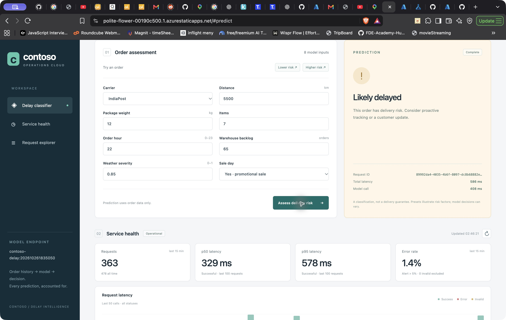

# Contoso Azure demo

[Watch or download the MP4](https://github.com/harshithRai/contoso-delay-classifier/releases/download/demo-2026-10-27/contoso-delay-demo.mp4) (3 minutes 47 seconds; about 7.7 MB).

The video covers architecture, actual AutoML metrics and limitations, a fresh live prediction, the same request in Cosmos Data Explorer, the health panel and load report, a deliberate wrong-key failure and restored inference.

The footage consists of actual Brave window frames captured approximately once per second during the demo. Chapters were edited and retimed to the computer-generated macOS Samantha narration. It is not a reconstruction of Azure screens. Screen sampling means the pointer motion is less smooth than a conventional high-frame-rate recording. [Narration](narration.md) and [chapter timings](chapters.json) are included.

The saved video's request IDs are independently verified in [azure-video.json](../evidence/azure-video.json). The exact failure and recovery cohorts are preserved, including successes during settings propagation. Model recall and load-test errors are disclosed in the main README.

The real API model key is restored. Training clusters are deleted. The live endpoint remains active for demo/grading and must be deleted afterward.
